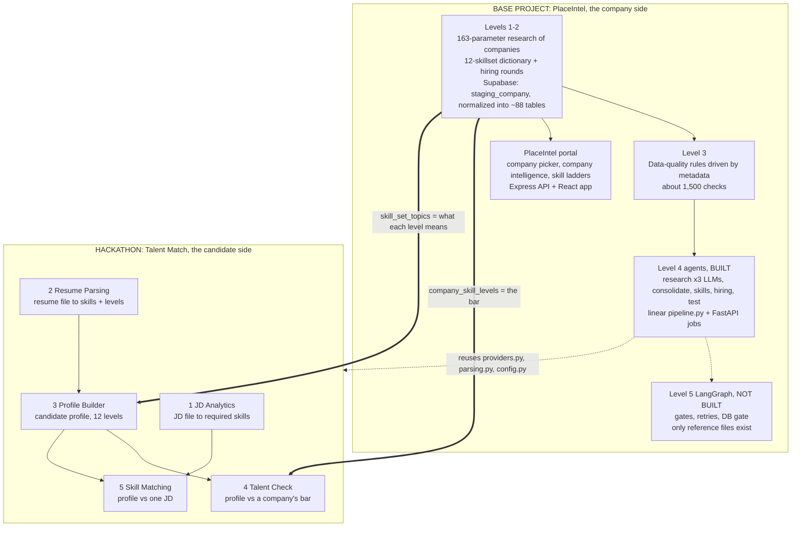
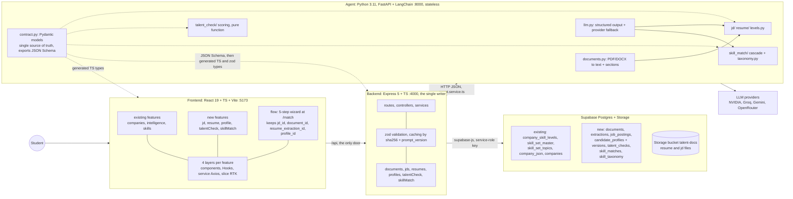
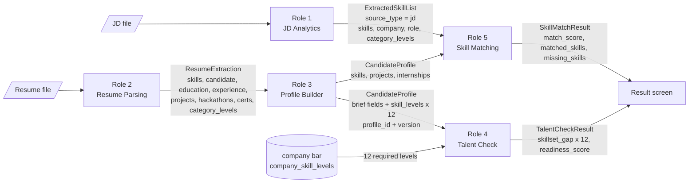
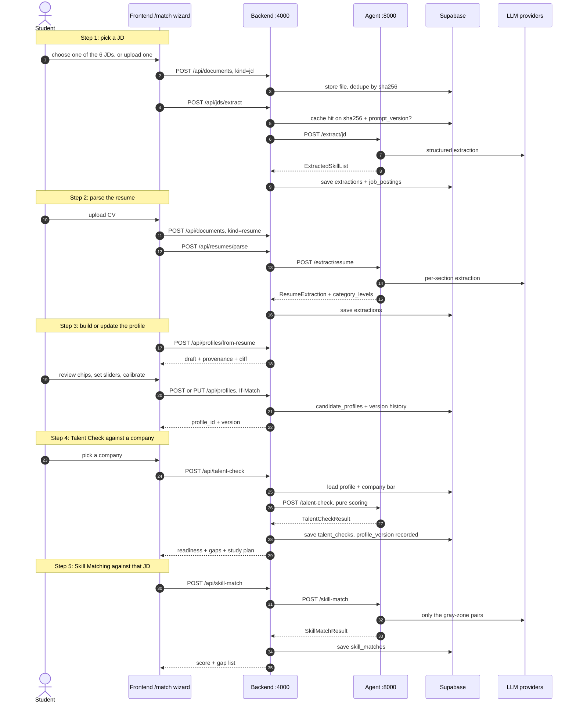
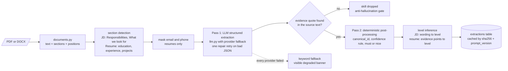
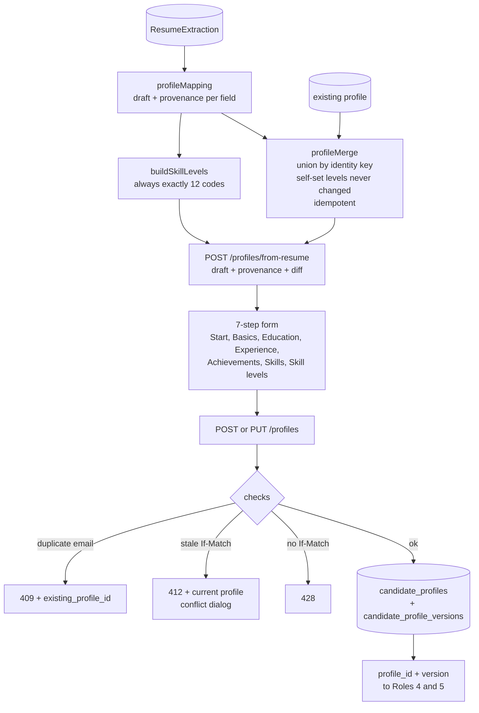
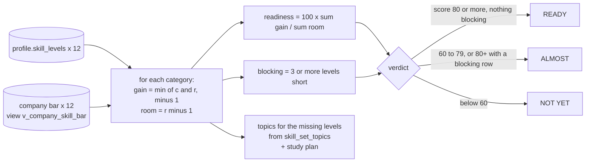
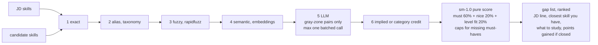
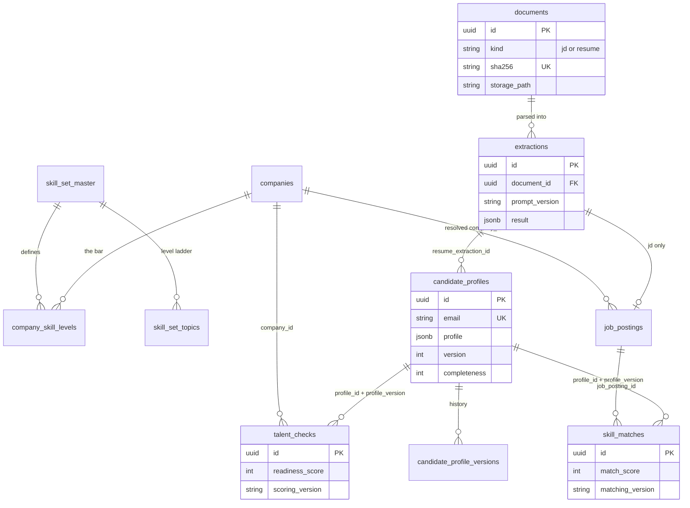
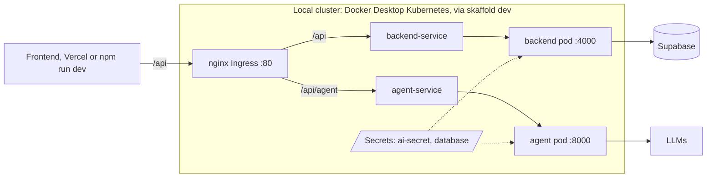

# RADIX Talent Match: architecture and flow

_A map of the whole system: the base project (PlaceIntel), the five hackathon features, how data moves between them, and where we are. Sources: the hackathon brief, [00-shared-contract.md](00-shared-contract.md) (locked v1.1) and the five role plans. Status in section 10 is as of 29 Oct 2026._

**Contents:** [1 Goal](#1-what-we-have-to-achieve) · [2 Base vs new](#2-base-project-versus-what-we-add) · [3 System](#3-system-architecture) · [4 The five features](#4-the-five-features-what-each-builds) · [5 Data contract](#5-the-shared-data-contract-what-flows-between-features) · [6 User flow](#6-the-user-flow) · [7 Role internals](#7-role-internals) · [8 Database](#8-database-existing-tables-and-new-ones) · [9 Delivery](#9-delivery-and-phases) · [10 Status](#10-where-we-are) · [11 Risks](#11-what-to-watch-for)

---

## 1. What we have to achieve

The brief asks for **one small, real, end-to-end tool that tells a candidate how ready they actually are for a specific job**, built on the same 12-skillset framework and real hiring data RADIX already researched.

- **The base project (PlaceIntel)** is the _company side_. It tells students what a visiting company tests, pays and expects.
- **The hackathon flips that lens to the candidate side.** Five team members each build one piece, then the pieces are wired into one flow.
- **"Done" means:**
  - all 5 pieces run on their own against at least 2 sample JDs or resumes;
  - they are wired into one flow for at least one company, JD and candidate;
  - Talent Check and Skill Matching give **visibly different results** for different candidates (the scoring is not a constant).
- **Test data:** 6 JDs (Google, Microsoft and Oracle FSS, 2 roles each) and 4 resumes (Ananya, Karthik, Priya, Rohan). Company bars are only needed for those 3 companies: Google is `company_id` 4, Microsoft 78, Oracle FSS 24.

---

## 2. Base project versus what we add

**What the new features reuse from the base**

- the 12 skillset definitions and 10-level topic ladders (`skill_set_topics`);
- each company's required level per skillset (`company_skill_levels`);
- the LLM provider wrappers (NVIDIA, Groq, Gemini);
- the markdown and JSON parsing helpers;
- the Express, FastAPI and React architecture, and the k8s setup.

---

## 3. System architecture

**Why it is split this way**

- The **agent is stateless compute**: extraction, level inference, scoring and matching. It never needs database credentials, so it scales horizontally.
- The **backend owns state**: uploads, Supabase reads and writes, caching and validation.
- `contract.py` generates the TypeScript and zod types, so the three services can't drift apart.
- Every LLM result is **cached by document hash**, so the same JD or resume is never paid for twice.
- **LLMs only extract or adjudicate. They never produce the final number.** Scores are pure, versioned functions, so they are explainable and testable.

---

## 4. The five features: what each builds

| # | Feature | Owner | Input | Output | Core idea |
|---|---|---|---|---|---|
| 1 | **JD Analytics** | Sahil | JD (PDF/DOCX) | `ExtractedSkillList` (jd) | LLM reads the prose, maps each requirement to one of the 12 categories plus named technologies, tags must or nice, and implies a level. Every skill must quote a sentence that is verified to exist in the JD, otherwise it is dropped. |
| 2 | **Resume Parsing** | Himanshu | Resume (PDF/DOCX) | `ResumeExtraction` | Same pattern for messy layouts. Also extracts education, experience, projects, hackathons and certifications. Infers a 1-10 level per category with a deterministic, explainable points model (`lv-1.0`); the LLM can only nudge it by ±1 and must cite evidence. Email and phone are masked before text reaches a third-party LLM. |
| 3 | **Profile Builder** | Raunak | Form, pre-filled from Role 2 | `CandidateProfile` | Plain code. The form, validation, JSON save/load and the 12 `skill_levels`, each tagged `resume_inferred`, `self` or `assessed`. Re-importing a CV merges and never overwrites. |
| 4 | **Talent Check** | Aryan | Saved profile + company | Readiness score + per-skillset gaps | Pure scoring against the company bar. |
| 5 | **Skill Matching** | Shreyansh | Profile or resume + one JD list | Match score + matched and missing skills | A 6-stage cascade (exact, alias, fuzzy, semantic, then an LLM only for the gray zone). A gap list with "points gained if closed". |

**The two scoring decisions (locked)**

- **Talent Check `tc-1.0`:** `readiness = 100 × Σ(min(c, r) − 1) / Σ(r − 1)`, where `c` is the candidate's level and `r` the company's required level.
  - A category is _blocking_ when it is 3 or more levels short.
  - **Ready** = score ≥ 80 and no blocking row. **Almost** = 60-79, or ≥ 80 with a blocking row. **Not yet** = below 60.
- **Skill Matching `sm-1.0`:** `100 × (0.60 × must_coverage + 0.20 × nice_coverage + 0.20 × level_fit)`.
  - Capped at 100 − 10 per missing must-have.
  - Capped at 49 when must coverage is below 50%.

---

## 5. The shared data contract: what flows between features

The 12 category codes are **COD, DSA, APTI, COMM, OOD, AI, SQL, SYSD, CLOUD, SWE, NETW, OS**. Anything else is `OTHER`.

**The one hole in the brief that Role 3 fills.** Talent Check compares `candidate_level` (1-10) per category, but the brief's profile only has a skill list. Our `skill_levels` field gives it exactly 12 levels, each an integer 1-10, with no zeros and no nulls. A category with no evidence is 1, low confidence, basis "no evidence".

---

## 6. The user flow

The **final screen** shows the Talent Check radar (candidate against the company bar) next to the Skill Match gap list. A **Compare candidates** toggle shows the 4 × 3 readiness heatmap and the 4 × 6 match grid. That one view proves the "visibly different results" requirement.

---

## 7. Role internals

### Roles 1 and 2: one shared extraction engine

### Role 3: Profile Builder (built)

### Role 4: Talent Check scoring

### Role 5: Skill Matching cascade

---

## 8. Database: existing tables and new ones

Existing tables are never modified. Roles 4 and 5 store `profile_version`, so an old score can always be explained on the exact profile it used.

---

## 9. Delivery and phases

| Phase | Goal |
|---|---|
| **P0** Contract, 27 Oct | `contract.py`, migrations and stub endpoints returning golden JSON, so Roles 3, 4 and 5 are unblocked at once |
| **P1** Done-by-brief | every role runs on at least 2 samples, plus one end-to-end flow (Google SWE × Ananya) |
| **P2** Stand-out | wizard, heatmaps, explanations, eval numbers, all 6 JDs × 4 resumes pre-computed |
| **P3** Scale story | jobs table with polling, pgvector taxonomy, batch endpoints (or slides only) |
| **Presentations** | 29 Oct peer round (45 min, top 9), 30 Oct expert panel (top 3), 31 Oct TGL Blitz finale. Each presentation covers the problem, the architecture, a live demo, and one challenge faced |

---

## 10. Where we are

_As of 29 Oct 2026._

- **Built and verified: Role 3**, backend and frontend, with 358 tests passing (173 backend, 185 frontend). Two things are left open: the SQL migration is not applied to Supabase, and the work is not committed.
- **Role 4:** the branch `origin/feature/aryan` has a `talent_match/talent_check/` package. Not reviewed.
- **Roles 1, 2 and 5:** on `main`, as of the last check, these exist only as plan documents.
- **Not in the repo yet:** `contract.py`, the JSON Schema export and `agent/src/talent_match/api.py`. They are listed in the contract's layout but don't exist, so the hand-written schemas stand in for them.
- **Still open from the base project:** the LangGraph pipeline (Level 5), a separate piece of work from Talent Match.

---

## 11. What to watch for

1. **Integration is the risk, not any single role.** The `flow` slice (the wizard that holds `jd_id`, `resume_extraction_id` and `profile_id`) has no owner in the five role plans. It belongs to the Scrum Master.
2. **Company bar data is messy.** Role 4's plan found that 698 of 1,380 Bloom codes disagree with their numeric level (Google Coding is stored as "8-CR", but 8 is EV). We score on the number.
3. **Oracle FSS must resolve to company 24, not Oracle India (company 3).** One pinned resolver, `resolveCompanyId()`, is shared by all roles.
4. **The demo needs the network to be reliable.** Every role has an offline fallback: an in-memory profile store, the company-bar snapshot, and cached extractions.
