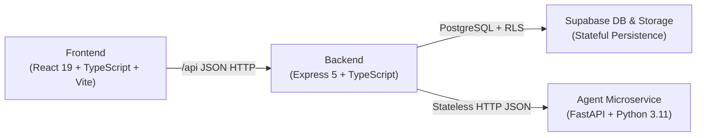
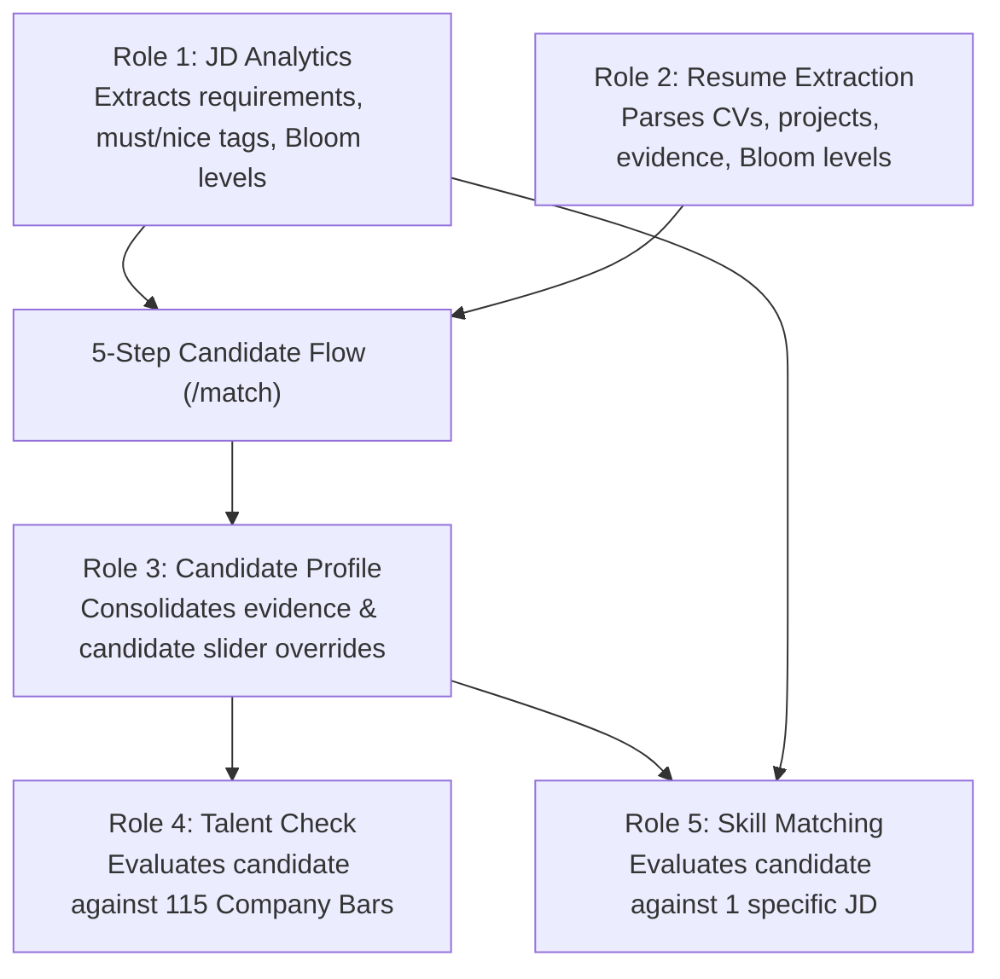
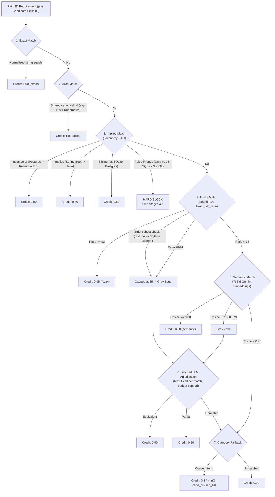

# RADIX Talent Match: Architecture & Role 5 Skill Matching Guide

This document provides a complete technical walkthrough of the **RADIX Talent Match** platform and a detailed reference for the **Role 5: Skill Matching** implementation, including data flow, the 7-stage cascade, mathematical scoring formulas, and file maps.

---

## 1. Project Overview & Architecture

### 1.1 The Core Problem
In campus placements and technical hiring:
- Keyword-based filtering fails: it misses semantic synonyms (e.g., searching for "Relational Databases" misses a candidate with "PostgreSQL"), while falsely matching distinct technologies ("Java" vs "JavaScript").
- Raw LLM-based matching is non-deterministic, slow, costly at scale, and provides un-auditable scores.
- Candidates receive arbitrary rejection percentages without knowing **what specific skills they missed, what category they belong to, how to bridge those gaps, or how many points closing a gap would yield**.

### 1.2 The 3-Tier Architecture



1. **Frontend (Presentation & Interaction)**: Built with React 19, TypeScript, Tailwind CSS, TanStack Router, and Redux Toolkit. Consumes backend endpoints via `/api`.
2. **Backend (State & Orchestration)**: Express 5 and TypeScript. Manages database transactions, file uploads to Supabase Storage, authentication, input assembly, and result caching.
3. **Agent Microservice (Pure Compute)**: Stateless Python 3.11 service with FastAPI and LangChain. Performs text extraction, level inference, Bloom taxonomy mapping, Talent Check benchmarking, and 7-stage skill matching without connecting directly to the DB.

---

## 2. The 5 Roles & Platform Lifecycle



| Role | Domain | Responsibilities | Core Output Object |
| :--- | :--- | :--- | :--- |
| **Role 1** | **JD Analytics** | Ingests job description PDFs/DOCXs, extracts requirements, marks must vs nice-to-have, and assigns Bloom target levels. | `ExtractedSkillList` (`source_type: "jd"`) |
| **Role 2** | **Resume Extraction** | Ingests candidate CVs, extracts education, experience, projects, and maps skills into 12 category levels based on evidence. | `ResumeExtraction` |
| **Role 3** | **Profile Builder** | Merges resume extraction with user-editable profiles. Allows candidates to tune skill levels via interactive sliders. | `CandidateProfile` |
| **Role 4** | **Talent Check** | Macro evaluation: Benchmarks a candidate against the hiring bars of 115 companies (Google, Microsoft, Oracle FSS, etc.). | `TalentCheckResult` (`readiness_score`) |
| **Role 5** | **Skill Matching** | Micro evaluation: Matches a candidate against a single job posting, prioritizes missing skills, and computes point impacts. | `SkillMatchResult` (`match_score`) |

### The 12 Canonical Skill Categories
All roles align on 12 standardized category codes scaled from Level 1 to 10 (CU, AP, AS, EV, CR):
1. **`COD`**: Coding (Syntax, Core Languages, Concurrency, Internals)
2. **`DSA`**: Data Structures & Algorithms
3. **`APTI`**: Aptitude & Problem Solving
4. **`COMM`**: Communication & Presentation Skills
5. **`OOD`**: Object-Oriented Programming & Design
6. **`AI`**: AI Native Engineering & Machine Learning
7. **`SQL`**: SQL & Relational Database Design
8. **`SYSD`**: System Design & Architecture
9. **`CLOUD`**: DevOps, Cloud Platforms & Containers
10. **`SWE`**: Software Engineering, Testing & Methodologies
11. **`NETW`**: Computer Networking
12. **`OS`**: Operating Systems & Kernel Internals
13. **`OTHER`**: Domain-specific skills (e.g. Banking, ERP)

---

## 3. Role 5: Skill Matching Implementation

### 3.1 Design Principles
- **Gap List First, Score Second**: The UI highlights what is missing before presenting the final score.
- **Every Match Explains Itself**: Every paired skill records its resolution method (`exact`, `alias`, `implied`, `fuzzy`, `semantic`, `llm`, `category`), its similarity ratio, credit value, and candidate evidence.
- **Cheap First, LLM Last**: Microsecond string algorithms and taxonomy lookups resolve the majority of pairs; only ambiguous "gray-zone" pairs reach the LLM in at most one batched call.
- **Deterministic & Versioned**: The score formula is a pure mathematical function (`sm-1.0`), guaranteeing repeatability.

---

### 3.2 The 7-Stage Cascade Engine



#### Detailed Stage Specifications:
1. **Exact Match (`credit: 1.00`)**: Case-insensitive, whitespace-normalized surface form equality.
2. **Alias Match (`credit: 1.00`)**: Resolved to identical `canonical_id` via the taxonomy index (e.g., `Golang` -> `golang`, `k8s` -> `kubernetes`).
3. **Implied Match (Taxonomy DAG)**:
   - `instance_of` (`0.90`): Candidate skill is a concrete subtype (e.g., candidate has `PostgreSQL`, JD asks for `Relational Databases`).
   - `implies` (`0.80`): Candidate skill directly implies the requirement (e.g., candidate has `Spring Boot`, JD asks for `Java`; `PyTorch` implies `Python`).
   - `general_form` (`0.60`): Candidate provides a general foundation (e.g., `SQL` for `PostgreSQL`).
   - `sibling` (`0.50`): Sibling technologies sharing a direct parent (e.g., `AWS` for `GCP`).
   - **False Friends Blocking**: Explicitly blocks pairs like `Java` vs `JavaScript`, `C` vs `C++`/`C#`, and `SQL` vs `NoSQL`.
4. **Fuzzy Match (RapidFuzz `token_set_ratio`)**:
   - `ratio >= 92`: Auto-accepted (`credit: 0.95`).
   - `78 <= ratio <= 91`: Routed to the Gray Zone.
   - `ratio < 78`: Rejected.
   - **Subset Rule**: If one token set strictly contains the other (e.g. `Python` vs `Python Django`), the ratio is capped at 85 to force LLM verification.
5. **Semantic Match (768-d Vector Embeddings)**:
   - Input format: `"{skill_name} ({category_code})"`.
   - `cosine >= 0.88`: Auto-accepted (`credit: 0.90`).
   - `0.76 <= cosine < 0.88`: Routed to the Gray Zone.
   - Cross-category comparison adds $+0.04$ to thresholds to reduce false matches.
6. **Batched LLM Adjudication**:
   - Gathers all gray-zone candidates into a single JSON payload.
   - Must-have requirements prioritized first; capped at `MAX_LLM_PAIRS = 40`.
   - Outputs: `equivalent` (`0.90`), `partial` (`0.50`), or `unrelated` (`0.00`).
   - Responses cached by `sha256(jd_term + cand_term + prompt_version)` to eliminate duplicate calls.
7. **Category Fallback**:
   - Used for broad concepts (e.g., "Strong CS fundamentals", "Problem solving", "Communication").
   - Evaluates the candidate's verified Bloom level in that category against the JD requirement:
     $$\text{credit} = 0.8 \times \min\left(1, \frac{\text{cand\_level}}{\text{req\_level}}\right) \times \text{confidence\_factor}$$

---

### 3.3 The Deterministic Scoring Engine (`sm-1.0`)

The final matching score is calculated via:

$$\text{raw} = 100 \times \left(0.60 \times \text{must\_coverage} + 0.20 \times \text{nice\_coverage} + 0.20 \times \text{level\_fit}\right)$$

Where:
- **`must_coverage`** $= \frac{\sum_{\text{must}} w_j c_j}{\sum_{\text{must}} w_j}$
- **`nice_coverage`** $= \frac{\sum_{\text{nice}} w_j c_j}{\sum_{\text{nice}} w_j}$ (if JD has no nice-to-haves, its 0.20 weight transfers to must)
- **`level_fit`** $= \frac{\sum_k \min(\text{cand}_k, \text{req}_k)}{\sum_k \text{req}_k}$ across required categories

#### Anti-Cheating & Missing Must-Have Capping Rules:
1. **Missing Must-Have Penalty**:
   $$\text{cap} = 100 - (10 \times N_{\text{missing\_must}})$$
   *(where a missing must-have is any mandatory requirement with credit $< 0.30$)*
2. **Coverage Floor Cap**:
   If $\text{must\_coverage} < 0.50$, the score is hard-capped at **49** (`cap_reason: "Must-have coverage under 50%"`).
3. **Final Score**:
   $$\text{match\_score} = \text{round}\left(\text{clamp}(\min(\text{raw}, \text{cap}), 0, 100)\right)$$

---

### 3.4 Counterfactual Impact Calculation

For every missing skill (credit $< 0.85$):
1. The engine simulates a counterfactual scenario where that specific requirement's credit is raised to $1.00$.
2. It recalculates the final score: $\Delta = \text{Score}_{\text{simulated}} - \text{Score}_{\text{current}}$.
3. The UI presents this delta directly on the gap card (e.g. `+8 pts`).
4. Gaps are categorized as:
   - **Quick Wins**: Gaps where the student has an adjacent skill in the taxonomy (e.g., student has `Docker`, JD wants `Kubernetes`) and shortfall $\le 1$.
   - **Big Gaps**: Core gaps with multi-level shortfalls and no direct precursor.
   - **Minor**: Partial gaps where impact is $< 2$ points.

---

## 4. End-to-End Request Data Flow

```mermaid
sequenceDiagram
    autonumber
    actor User as User / Browser
    participant FE as Frontend (React / Redux)
    participant BE as Backend (Express 5)
    participant DB as Supabase DB
    participant AG as Agent (FastAPI / Python)

    User->>FE: Selects Candidate ("Ananya Rao") & Target JD ("Google SWE")
    FE->>BE: POST /api/skill-match { profile_id, jd_id, refresh: false }

    rect rgb(20, 25, 35)
        Note over BE,DB: Step 1: Cache Verification & Input Assembly
        BE->>DB: Query skill_matches for (profile_id, jd_id, sm-1.0)
        alt Cache Hit (refresh == false)
            DB-->>BE: Return cached result
        else Cache Miss
            BE->>DB: Query CandidateProfile, JobPosting extraction, & skill_set_topics
            DB-->>BE: Return inputs
            BE->>AG: POST /skill-match { jd, profile, topics, options }

            rect rgb(25, 35, 45)
                Note over AG: Step 2: Stateless Pure Matching Engine
                AG->>AG: build_jd_terms() & build_candidate_terms()
                AG->>AG: run_cascade() [Stages 1-5 & 7]
                opt Gray Zone candidates present
                    AG->>AG: adjudicate() [One batched LLM call]
                end
                AG->>AG: score() [sm-1.0 formula + cap rules]
                AG->>AG: build_missing() [Counterfactual simulations]
            end

            AG-->>BE: Return SkillMatchResult
            BE->>DB: INSERT into skill_matches
        end
    end

    BE-->>FE: Return SkillMatchResult (JSON)
    FE->>FE: Redux dispatch(setMatchResult)
    FE-->>User: Renders MatchScoreCard, GapList (+pts), and MatchLinksView
```



---

## 5. File Inventory & Reference Map

### Agent Layer (`agent/src/talent_match/`)
- `contract.py`: Pydantic v2 data models for `MatchedSkill`, `MissingSkill`, `SkillMatchResult`, `ScoreBreakdown`, `SkillMatchRequest`, `SkillMatchBatchRequest`, and `BatchMatrixCell`.
- `skill_match/params.py`: Centralized configuration constants: `MATCHING_VERSION = "sm-1.0"`, stage thresholds, weights, and credits.
- `skill_match/normalize.py`: Surface string normalization, filler removal, version stripping, and compound splitting.
- `taxonomy.py`: In-memory taxonomy graph, alias resolver, ancestor and implication closures, and distinct false-friends pairs.
- `skill_match/terms.py`: Term preparation, deduplication, evidence factor assignments, and alternative group clustering.
- `skill_match/embeddings.py`: Vector embedding protocol, Gemini embedder integration, snapshot fallback, and cosine similarity matrix calculation.
- `skill_match/adjudicate.py`: Batched LLM adjudication using structured outputs and persistent verdict caching.
- `skill_match/cascade.py`: Implementation of the 7-stage matching cascade.
- `skill_match/scoring.py`: The `sm-1.0` pure mathematical scoring function and counterfactual delta calculation.
- `skill_match/gaps.py`: Ranked missing skills builder, taxonomy-based closest skill finder, and topic ladder study recommendations.
- `skill_match/service.py`: High-level orchestration for individual and batch match workflows.
- `skill_match/router.py`: FastAPI route handlers for `/skill-match` and `/skill-match/batch`.

### Backend Layer (`backend/src/`)
- `supabase/migrations/20261027_05_skill_match.sql`: PostgreSQL DDL for `skill_taxonomy` and `skill_matches` tables with GIN and compound indexes.
- `services/topics.service.ts`: Service loading topics from the DB with fallback to standard 12-category topic ladders.
- `services/skillMatch.service.ts`: Backend orchestrator managing DB reads/writes, agent proxying, and batch matrix evaluations.
- `controllers/skillMatch.controller.ts`: Zod validation schemas and Express controllers.
- `routes/skillMatch.routes.ts`: Routes mounted under `/api/skill-match`.

### Frontend Layer (`frontend/src/features/skillMatch/`)
- `service/skillMatch.api.ts`: Typed Axios API client for single match and matrix endpoints.
- `slice/skillMatch.slice.ts`: Synchronous Redux slice tracking match results, loading states, filters, and matrix data.
- `Hooks/skillMatch.hooks.ts`: Custom React hooks (`useSkillMatch`, `useSkillMatchMatrix`, `useGapGroups`, `useSkillMatchUI`).
- `components/MatchScoreCard.tsx`: Displays match score, fit band, component coverage bars, and cap warnings.
- `components/GapList.tsx`: Renders missing skills grouped into Quick Wins, Big Gaps, and Minor, complete with `+pts` badges and study paths.
- `components/MatchLinksView.tsx`: Displays two-column alignment showing how each JD requirement was matched, color-coded by stage.
- `components/MatchMatrix.tsx`: Interactive candidate $\times$ JD heatmap matrix.
- `components/HowComputedDrawer.tsx`: Provenance drawer detailing execution latencies, LLM pair counts, and stage distribution.
- `components/SkillMatchPage.tsx`: Primary container page integrating candidate/JD selectors, tabs, and detail views.
- `routes/skill-match.tsx`: TanStack file-based route registration.

---

## 6. Verification & Test Commands

### Running Agent Unit Tests
```bash
# In the agent virtual environment:
agent\.venv\Scripts\python.exe -m pytest agent/tests/skill_match
```
Covers:
- `test_normalize.py`: Verifies version stripping, filler removal, and compound splitting.
- `test_taxonomy.py`: Verifies resolution, graph ancestor/implies closures, cycle prevention, and false-friends blocking.
- `test_match_scoring.py`: Verifies the section 3.7 worked example (score 71, cap 90, Kubernetes +8 pts).
- `test_cascade.py`: Verifies exact, alias, implied, and false-friend isolation.

### Running Backend Integration Tests
```bash
npm --prefix backend test run test/skillMatch.test.ts
```
Verifies:
- `POST /api/skill-match` input validation and agent proxying.
- `GET /api/skill-match/matrix` grid generation.

### Running Frontend Tests & Typecheck
```bash
# Redux slice unit tests
cd frontend && npx vitest run src/features/skillMatch/skillMatch.slice.test.ts

# TypeScript verification
cd frontend && npx tsc --noEmit

# Production bundle build
cd frontend && npx vite build
```

